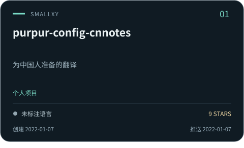
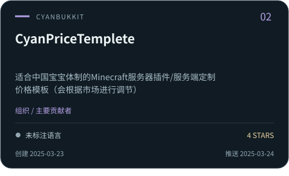
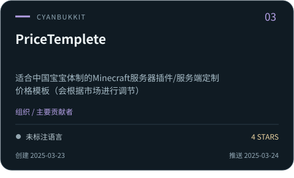
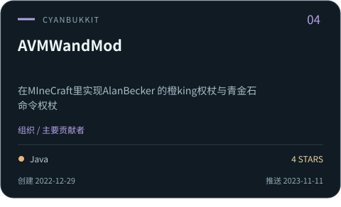

<picture>
  <source media="(max-width: 600px)" srcset="assets/hero-mobile.svg">
  
</picture>

 

  

<h3 align="center">你好，我是六欲玄易。也可以叫我 SmallXY。</h3>

  在 Minecraft 里搭世界，在 AI 里试脑洞，在 XR 里找另一种可能。 
  认真做有趣的东西，偶尔让代码成为行为艺术。

  <a href="https://github.com/CyanBukkit">CyanBukkit</a> ·
  <a href="https://github.com/OpenMCSMG">OpenMCSMG</a> ·
  <a href="https://gitee.com/cyanbukkit">Gitee</a> ·
  <a href="https://www.cyanbukkit.cn">个人网站</a> ·
  <a href="https://space.bilibili.com/60051886">Bilibili</a>

---

<!-- PROFILE:START -->
<!-- Generated from public GitHub API data. Do not edit this section by hand. -->
<picture>
  <source media="(max-width: 600px)" srcset="assets/generated/stats-mobile.svg">
  
</picture>

数据更新于 2026-11-25 08:51:46 UTC · 仅公开数据 · [统计口径](docs/profile.md#统计口径)

## 01 / 被星光选中的作品

个人项目，以及我在组织中提交数第一（含并列）的项目。按 Star 排序，排除 Fork、归档和介绍仓库。

## 02 / 最近种下的想法

同一作品范围，按仓库创建日期排序。不是发布日，也不等同于项目实际启动日。

**2026-11-13** · [minecraft-animation](https://github.com/CyanBukkit/minecraft-animation) 
CyanBukkit / 组织 · 主要贡献者 · 最近推送 2026-11-13 UTC

**2026-10-08** · [Codex-CTX-Guard](https://github.com/CyanBukkit/Codex-CTX-Guard) 
CyanBukkit / 组织 · 主要贡献者 · 最近推送 2026-10-08 UTC

**2026-05-31** · [PicoXR-Doc-MCP](https://github.com/CyanBukkit/PicoXR-Doc-MCP) 
CyanBukkit / 组织 · 主要贡献者 · 最近推送 2026-06-01 UTC

## 03 / 一起写过的世界

组织不是一个人的作品。这里记录我参与的部分，也保留它们原本的归属。

展开组织主要贡献项目、提交数与 Star

“主要贡献”仅指 GitHub Contributors 中账号关联提交数第一；不代表创始人、唯一作者或维护者身份。提交统计可能有数小时缓存。

| 组织项目 | 我的提交 / 最高提交 | Star | 仓库创建（UTC） |
| :--- | ---: | ---: | :--- |
| [CyanBukkit/CyanTemplete4TraeAI](https://github.com/CyanBukkit/CyanTemplete4TraeAI) | 52 / 52 | 1 | 2025-02-26 |
| [CyanBukkit/CC-Next](https://github.com/CyanBukkit/CC-Next) · 已归档 | 19 / 19 | 1 | 2026-07-08 |
| [CyanBukkit/qianniu-cli-macos](https://github.com/CyanBukkit/qianniu-cli-macos) · 已归档 | 18 / 18 | 5 | 2026-05-14 |
| [CyanBukkit/.github](https://github.com/CyanBukkit/.github) | 16 / 16 | 1 | 2025-02-15 |
| [OpenMCSMG/SiModule-BuildAndPlace](https://github.com/OpenMCSMG/SiModule-BuildAndPlace) | 13 / 13 | 0 | 2024-05-07 |
| [CyanBukkit/CyanMenu](https://github.com/CyanBukkit/CyanMenu) | 11 / 11 | 1 | 2025-03-10 |
| [CyanBukkit/CyanPriceTemplete](https://github.com/CyanBukkit/CyanPriceTemplete) | 10 / 10 | 4 | 2025-03-23 |
| [CyanBukkit/NukkitPluginTemplete](https://github.com/CyanBukkit/NukkitPluginTemplete) | 10 / 10 | 0 | 2026-03-16 |
| [OpenMCSMG/SiModule-Slope](https://github.com/OpenMCSMG/SiModule-Slope) | 9 / 9 | 0 | 2024-05-07 |
| [OpenMCSMG/SiModuleGame-Bukkit](https://github.com/OpenMCSMG/SiModuleGame-Bukkit) | 9 / 9 | 0 | 2024-08-01 |
| [CyanBukkit/CyanMVPluginTemplate](https://github.com/CyanBukkit/CyanMVPluginTemplate) | 7 / 7 | 0 | 2025-05-15 |
| [OpenMCSMG/SiModule-Lollipop](https://github.com/OpenMCSMG/SiModule-Lollipop) | 7 / 7 | 0 | 2024-05-22 |
| [OpenMCSMG/SiModule-NewBieSpawnEntity](https://github.com/OpenMCSMG/SiModule-NewBieSpawnEntity) | 7 / 7 | 0 | 2024-05-10 |
| [OpenMCSMG/SiModule-PlantSugarbeet](https://github.com/OpenMCSMG/SiModule-PlantSugarbeet) | 7 / 7 | 0 | 2024-05-07 |
| [CyanBukkit/AVMWandMod](https://github.com/CyanBukkit/AVMWandMod) | 6 / 6 | 4 | 2022-12-29 |
| [CyanBukkit/BungeeRejoin](https://github.com/CyanBukkit/BungeeRejoin) | 6 / 6 | 1 | 2023-06-10 |
| [OpenMCSMG/SiModule-Templete](https://github.com/OpenMCSMG/SiModule-Templete) | 6 / 6 | 1 | 2024-05-07 |
| [OpenMCSMG/MCSManager-Super](https://github.com/OpenMCSMG/MCSManager-Super) | 5 / 5 | 1 | 2024-05-11 |
| [OpenMCSMG/SiModule-GrowWheat](https://github.com/OpenMCSMG/SiModule-GrowWheat) | 5 / 5 | 0 | 2024-07-10 |
| [CyanBukkit/FindClue](https://github.com/CyanBukkit/FindClue) | 4 / 4 | 0 | 2023-08-03 |
| [CyanBukkit/mcMMo](https://github.com/CyanBukkit/mcMMo) | 4 / 4 | 1 | 2024-05-03 |
| [OpenMCSMG/.github](https://github.com/OpenMCSMG/.github) | 4 / 4 | 0 | 2024-05-07 |
| [OpenMCSMG/SiModule-TNT](https://github.com/OpenMCSMG/SiModule-TNT) | 4 / 4 | 0 | 2024-05-14 |
| [CyanBukkit/CyanBukkit-MCP](https://github.com/CyanBukkit/CyanBukkit-MCP) | 3 / 3 | 1 | 2026-05-26 |
| [CyanBukkit/CyanInvite](https://github.com/CyanBukkit/CyanInvite) | 3 / 3 | 0 | 2025-03-10 |
| [OpenMCSMG/SiModule-AllMusicAddon](https://github.com/OpenMCSMG/SiModule-AllMusicAddon) | 3 / 3 | 0 | 2024-05-14 |
| [CyanBukkit/AreYouDie](https://github.com/CyanBukkit/AreYouDie) | 2 / 2 | 0 | 2026-01-12 |
| [CyanBukkit/BukkitGenesis](https://github.com/CyanBukkit/BukkitGenesis) · 已归档 | 2 / 2 | 1 | 2024-10-12 |
| [CyanBukkit/PicoXR-Doc-MCP](https://github.com/CyanBukkit/PicoXR-Doc-MCP) | 2 / 2 | 0 | 2026-05-31 |
| [CyanBukkit/minecraft-animation](https://github.com/CyanBukkit/minecraft-animation) | 2 / 2 | 0 | 2026-11-13 |
| [OpenMCSMG/SiModule-SoundPack](https://github.com/OpenMCSMG/SiModule-SoundPack) | 2 / 2 | 0 | 2024-07-08 |
| [CyanBukkit/Codex-CTX-Guard](https://github.com/CyanBukkit/Codex-CTX-Guard) | 1 / 1 | 0 | 2026-10-08 |
| [CyanBukkit/CustomerBedWars](https://github.com/CyanBukkit/CustomerBedWars) | 1 / 1 | 0 | 2026-05-30 |
| [CyanBukkit/CyanFabricTemplate](https://github.com/CyanBukkit/CyanFabricTemplate) | 1 / 1 | 0 | 2025-04-12 |
| [CyanBukkit/ForgeBukkitServerDownload](https://github.com/CyanBukkit/ForgeBukkitServerDownload) | 1 / 1 | 0 | 2023-11-21 |
| [OpenMCSMG/SiModule-ItemSpray](https://github.com/OpenMCSMG/SiModule-ItemSpray) | 1 / 1 | 0 | 2024-05-19 |

展开外部仓库参与证据

按公开默认分支 Commit、公开 PR 与公开组织 Contributors 去重；不含个人名下仓库，也不是 GitHub 全量贡献图。PR 记录不等于已合并。

- [CyanBukkit/.github](https://github.com/CyanBukkit/.github) — [Commit](https://github.com/CyanBukkit/.github/commit/c23ec55d5d271e8183114299fab7bb00e4d47f6d) / [Contributors](https://api.github.com/repos/CyanBukkit/.github/contributors)
- [CyanBukkit/AVMWandMod](https://github.com/CyanBukkit/AVMWandMod) — [Commit](https://github.com/CyanBukkit/AVMWandMod/commit/37790603090b0567e2b9464977a36dc3be0eebee) / [Contributors](https://api.github.com/repos/CyanBukkit/AVMWandMod/contributors)
- [CyanBukkit/AreYouDie](https://github.com/CyanBukkit/AreYouDie) — [Commit](https://github.com/CyanBukkit/AreYouDie/commit/865e12eac9f943287b50357c95c5cfd1dede60ec) / [Contributors](https://api.github.com/repos/CyanBukkit/AreYouDie/contributors)
- [CyanBukkit/BukkitGenesis](https://github.com/CyanBukkit/BukkitGenesis) — [Commit](https://github.com/CyanBukkit/BukkitGenesis/commit/9de3d55493b781f9303478e78405f836969b556d) / [Contributors](https://api.github.com/repos/CyanBukkit/BukkitGenesis/contributors)
- [CyanBukkit/BungeeRejoin](https://github.com/CyanBukkit/BungeeRejoin) — [Commit](https://github.com/CyanBukkit/BungeeRejoin/commit/7d0762747b9545958fa62b5b20b40a80936714b5) / [Contributors](https://api.github.com/repos/CyanBukkit/BungeeRejoin/contributors)
- [CyanBukkit/CC-Next](https://github.com/CyanBukkit/CC-Next) — [Commit](https://github.com/CyanBukkit/CC-Next/commit/25867e495140eeb04fc6bcf645f5c2d5c297bade) / [Contributors](https://api.github.com/repos/CyanBukkit/CC-Next/contributors)
- [CyanBukkit/Codex-CTX-Guard](https://github.com/CyanBukkit/Codex-CTX-Guard) — [Commit](https://github.com/CyanBukkit/Codex-CTX-Guard/commit/81162aa55f0e83c93278ef8bd724276379ac1b1d) / [Contributors](https://api.github.com/repos/CyanBukkit/Codex-CTX-Guard/contributors)
- [CyanBukkit/CustomerBedWars](https://github.com/CyanBukkit/CustomerBedWars) — [Commit](https://github.com/CyanBukkit/CustomerBedWars/commit/0d333575d620e54915d23114f731e62e24df0d68) / [Contributors](https://api.github.com/repos/CyanBukkit/CustomerBedWars/contributors)
- [CyanBukkit/CyanBukkit-MCP](https://github.com/CyanBukkit/CyanBukkit-MCP) — [Commit](https://github.com/CyanBukkit/CyanBukkit-MCP/commit/98f59330089887bdf996928a49933778dec2c963) / [Contributors](https://api.github.com/repos/CyanBukkit/CyanBukkit-MCP/contributors)
- [CyanBukkit/CyanFabricTemplate](https://github.com/CyanBukkit/CyanFabricTemplate) — [Commit](https://github.com/CyanBukkit/CyanFabricTemplate/commit/327fabb80481cc4eb0ae189e3826469c92f25a91) / [Contributors](https://api.github.com/repos/CyanBukkit/CyanFabricTemplate/contributors)
- [CyanBukkit/CyanInvite](https://github.com/CyanBukkit/CyanInvite) — [Commit](https://github.com/CyanBukkit/CyanInvite/commit/ddc16572f3116c31b7787af85c92b3402e5ecde4) / [Contributors](https://api.github.com/repos/CyanBukkit/CyanInvite/contributors)
- [CyanBukkit/CyanMVPluginTemplate](https://github.com/CyanBukkit/CyanMVPluginTemplate) — [Commit](https://github.com/CyanBukkit/CyanMVPluginTemplate/commit/e7940be10a191e0da81c7d90f8ceeaac02cef17c) / [Contributors](https://api.github.com/repos/CyanBukkit/CyanMVPluginTemplate/contributors)
- [CyanBukkit/CyanMenu](https://github.com/CyanBukkit/CyanMenu) — [Commit](https://github.com/CyanBukkit/CyanMenu/commit/def0b8cb3aba6ea6e331fe6ef3d60504a166c175) / [Contributors](https://api.github.com/repos/CyanBukkit/CyanMenu/contributors)
- [CyanBukkit/CyanPriceTemplete](https://github.com/CyanBukkit/CyanPriceTemplete) — [Commit](https://github.com/CyanBukkit/CyanPriceTemplete/commit/dd0e9e170bede3115d9800157d60cfbe4e498b59) / [Contributors](https://api.github.com/repos/CyanBukkit/CyanPriceTemplete/contributors)
- [CyanBukkit/CyanTemplete4TraeAI](https://github.com/CyanBukkit/CyanTemplete4TraeAI) — [Commit](https://github.com/CyanBukkit/CyanTemplete4TraeAI/commit/4f235c5abc1a9eeb61759a879ab29b91ed099670) / [Contributors](https://api.github.com/repos/CyanBukkit/CyanTemplete4TraeAI/contributors)
- [CyanBukkit/FindClue](https://github.com/CyanBukkit/FindClue) — [Commit](https://github.com/CyanBukkit/FindClue/commit/ff9936373c4edd999a568ff00895dea9fffc64a5) / [Contributors](https://api.github.com/repos/CyanBukkit/FindClue/contributors)
- [CyanBukkit/ForgeBukkitServerDownload](https://github.com/CyanBukkit/ForgeBukkitServerDownload) — [Commit](https://github.com/CyanBukkit/ForgeBukkitServerDownload/commit/bf9f8e0b919de9df6ceadd89c6e34ae8778fc2c7) / [Contributors](https://api.github.com/repos/CyanBukkit/ForgeBukkitServerDownload/contributors)
- [CyanBukkit/NukkitPluginTemplete](https://github.com/CyanBukkit/NukkitPluginTemplete) — [Commit](https://github.com/CyanBukkit/NukkitPluginTemplete/commit/fab59973bef192b1b2a304fd247b7d536a5258ab) / [Contributors](https://api.github.com/repos/CyanBukkit/NukkitPluginTemplete/contributors)
- [CyanBukkit/PicoXR-Doc-MCP](https://github.com/CyanBukkit/PicoXR-Doc-MCP) — [Commit](https://github.com/CyanBukkit/PicoXR-Doc-MCP/commit/58b4a378a84fcc79ad444e5fb2b59bec113d3773) / [Contributors](https://api.github.com/repos/CyanBukkit/PicoXR-Doc-MCP/contributors)
- [CyanBukkit/ZhouYiFish](https://github.com/CyanBukkit/ZhouYiFish) — [PR](https://github.com/CyanBukkit/ZhouYiFish/pull/4)
- [CyanBukkit/mcMMo](https://github.com/CyanBukkit/mcMMo) — [Commit](https://github.com/CyanBukkit/mcMMo/commit/49586f92a674848d7650b364c0f8e6397f8f9dab) / [Contributors](https://api.github.com/repos/CyanBukkit/mcMMo/contributors)
- [CyanBukkit/minecraft-animation](https://github.com/CyanBukkit/minecraft-animation) — [Commit](https://github.com/CyanBukkit/minecraft-animation/commit/cdae76be757e70081a5c1819b97fc3e1551aa2b9) / [Contributors](https://api.github.com/repos/CyanBukkit/minecraft-animation/contributors)
- [CyanBukkit/qianniu-cli-macos](https://github.com/CyanBukkit/qianniu-cli-macos) — [Commit](https://github.com/CyanBukkit/qianniu-cli-macos/commit/7c967e3a4d2daba19397b47986decd5da444cd47) / [Contributors](https://api.github.com/repos/CyanBukkit/qianniu-cli-macos/contributors)
- [LYOfficial/BBSPK](https://github.com/LYOfficial/BBSPK) — [Commit](https://github.com/LYOfficial/BBSPK/commit/04330bb132246a88447dd03356bec82290e5608e) / [PR](https://github.com/LYOfficial/BBSPK/pull/214)
- [MCNeteaseDevs/modsdk&#95;mcp&#95;server](https://github.com/MCNeteaseDevs/modsdk_mcp_server) — [PR](https://github.com/MCNeteaseDevs/modsdk_mcp_server/pull/5)
- [MinestomCN/.github](https://github.com/MinestomCN/.github) — [Commit](https://github.com/MinestomCN/.github/commit/0cf3822a3852bc6e1c68e730f68f7b95dbceb088)
- [MinestomCN/minestom.cn-backend](https://github.com/MinestomCN/minestom.cn-backend) — [Commit](https://github.com/MinestomCN/minestom.cn-backend/commit/e436bcc2d21b742fb3e9f90bd50bf055211f2d99)
- [OpenMCSMG/.github](https://github.com/OpenMCSMG/.github) — [Commit](https://github.com/OpenMCSMG/.github/commit/703aa77218131ddea09af78db4f115559c69be2b) / [Contributors](https://api.github.com/repos/OpenMCSMG/.github/contributors)
- [OpenMCSMG/MCSManager-Super](https://github.com/OpenMCSMG/MCSManager-Super) — [Commit](https://github.com/OpenMCSMG/MCSManager-Super/commit/e6ea749852674abffc9305f4e5e08f7574a38e76) / [Contributors](https://api.github.com/repos/OpenMCSMG/MCSManager-Super/contributors)
- [OpenMCSMG/SiModule-AllMusicAddon](https://github.com/OpenMCSMG/SiModule-AllMusicAddon) — [Commit](https://github.com/OpenMCSMG/SiModule-AllMusicAddon/commit/f99013fd56621af1cd011f66705abb47d9b3f0da) / [Contributors](https://api.github.com/repos/OpenMCSMG/SiModule-AllMusicAddon/contributors)
- [OpenMCSMG/SiModule-BuildAndPlace](https://github.com/OpenMCSMG/SiModule-BuildAndPlace) — [Commit](https://github.com/OpenMCSMG/SiModule-BuildAndPlace/commit/48efae500964f9aad52889cf44afe9649118ada4) / [Contributors](https://api.github.com/repos/OpenMCSMG/SiModule-BuildAndPlace/contributors)
- [OpenMCSMG/SiModule-GrowWheat](https://github.com/OpenMCSMG/SiModule-GrowWheat) — [Commit](https://github.com/OpenMCSMG/SiModule-GrowWheat/commit/36dbdaf53cfccf32167e96c4b3222ef47f3ac72f) / [Contributors](https://api.github.com/repos/OpenMCSMG/SiModule-GrowWheat/contributors)
- [OpenMCSMG/SiModule-ItemSpray](https://github.com/OpenMCSMG/SiModule-ItemSpray) — [Commit](https://github.com/OpenMCSMG/SiModule-ItemSpray/commit/2304b3eb4e231fe6736b7926dca766e5877103eb) / [Contributors](https://api.github.com/repos/OpenMCSMG/SiModule-ItemSpray/contributors)
- [OpenMCSMG/SiModule-Lollipop](https://github.com/OpenMCSMG/SiModule-Lollipop) — [Commit](https://github.com/OpenMCSMG/SiModule-Lollipop/commit/746006738304fe8471caa09910cc98c910df3568) / [Contributors](https://api.github.com/repos/OpenMCSMG/SiModule-Lollipop/contributors)
- [OpenMCSMG/SiModule-NewBieSpawnEntity](https://github.com/OpenMCSMG/SiModule-NewBieSpawnEntity) — [Commit](https://github.com/OpenMCSMG/SiModule-NewBieSpawnEntity/commit/af2df7ad4e70734ad546d3ac49ff7d9c51ade3df) / [Contributors](https://api.github.com/repos/OpenMCSMG/SiModule-NewBieSpawnEntity/contributors)
- [OpenMCSMG/SiModule-PlantSugarbeet](https://github.com/OpenMCSMG/SiModule-PlantSugarbeet) — [Commit](https://github.com/OpenMCSMG/SiModule-PlantSugarbeet/commit/15443b55320bf2fb99675b9b682bb65a940f9ca8) / [Contributors](https://api.github.com/repos/OpenMCSMG/SiModule-PlantSugarbeet/contributors)
- [OpenMCSMG/SiModule-Slope](https://github.com/OpenMCSMG/SiModule-Slope) — [Commit](https://github.com/OpenMCSMG/SiModule-Slope/commit/f371e79b8283ad801cb7d125805e47700d2f37b1) / [Contributors](https://api.github.com/repos/OpenMCSMG/SiModule-Slope/contributors)
- [OpenMCSMG/SiModule-SoundPack](https://github.com/OpenMCSMG/SiModule-SoundPack) — [Commit](https://github.com/OpenMCSMG/SiModule-SoundPack/commit/304d3313d14e5054b84055ac8b25aceaaffe4804) / [Contributors](https://api.github.com/repos/OpenMCSMG/SiModule-SoundPack/contributors)
- [OpenMCSMG/SiModule-TNT](https://github.com/OpenMCSMG/SiModule-TNT) — [Commit](https://github.com/OpenMCSMG/SiModule-TNT/commit/a929305a12f1c46ee867cb31b83845d4350973e7) / [Contributors](https://api.github.com/repos/OpenMCSMG/SiModule-TNT/contributors)
- [OpenMCSMG/SiModule-Templete](https://github.com/OpenMCSMG/SiModule-Templete) — [Commit](https://github.com/OpenMCSMG/SiModule-Templete/commit/07a6066bc09d2c335c1cd100f345b151c0526ff7) / [Contributors](https://api.github.com/repos/OpenMCSMG/SiModule-Templete/contributors)
- [OpenMCSMG/SiModuleGame-Bukkit](https://github.com/OpenMCSMG/SiModuleGame-Bukkit) — [Commit](https://github.com/OpenMCSMG/SiModuleGame-Bukkit/commit/9de1aa8f518d26ebbab78d5a370e0f4d2ff71cc1) / [Contributors](https://api.github.com/repos/OpenMCSMG/SiModuleGame-Bukkit/contributors)
- [WaiGameStudio/.github](https://github.com/WaiGameStudio/.github) — [Commit](https://github.com/WaiGameStudio/.github/commit/e9043e513e09b141588c23d32879cd45abe1bb08)
- [WaiGameStudio/GadgetsMenu](https://github.com/WaiGameStudio/GadgetsMenu) — [Commit](https://github.com/WaiGameStudio/GadgetsMenu/commit/7bc045d21ebe95f6e45b15bb49f93f92090fcbb8)

GitHub 起点：2020-03-17 · 公开组织：CyanBukkit / OpenMCSMG · [数据快照](docs/profile-data.json) · [更新方式](docs/profile.md)
<!-- PROFILE:END -->

## 04 / 换个地方，继续创造

这些项目已迁移到 **[Gitee / CyanBukkit](https://gitee.com/cyanbukkit)**。GitHub 榜单只统计当前仍公开可见的仓库；迁移入口不重复计入上方数量或 Star。

- [CyanShop_Backend](https://gitee.com/cyanbukkit/CyanShop_Backend) / 网店后端服务
- [CyanShop_Frontend](https://gitee.com/cyanbukkit/CyanShop_Frontend) / 网店前端
- [CyanBukkitOfficial](https://gitee.com/cyanbukkit/CyanBukkitOfficial) / 官网介绍页
- [PriceTemplete](https://gitee.com/cyanbukkit/PriceTemplete) / 定价模板
- [qianniu-cli-macos](https://gitee.com/cyanbukkit/qianniu-cli-macos) / 千牛智能客服
- [Cyanbukkit_api_microsoft](https://gitee.com/cyanbukkit/Cyanbukkit_api_microsoft) / 服务器登录对接

---

  <strong>脑洞不设限，热爱有回响。</strong> 
  MINECRAFT / AI / XR / OPEN SOURCE

